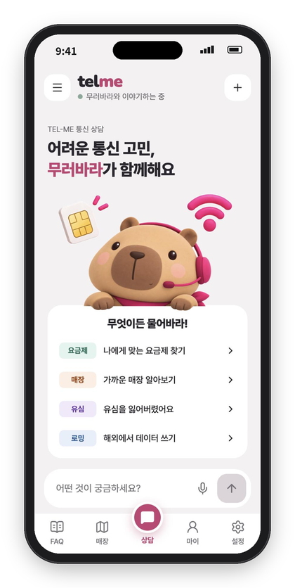
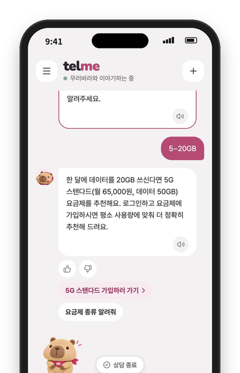
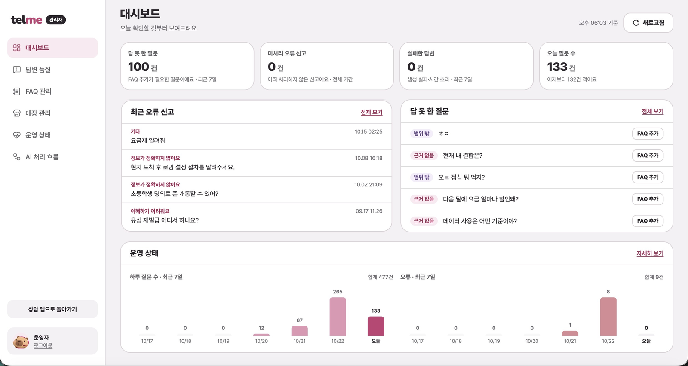
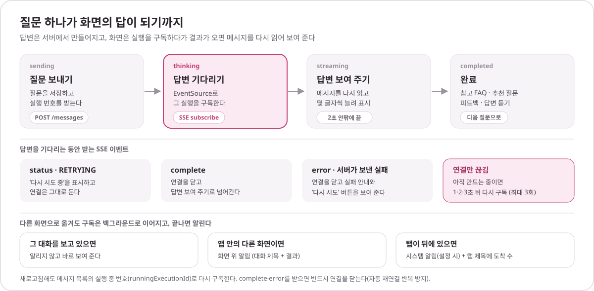

<div align="center">

<picture>
  <source media="(prefers-color-scheme: dark)" srcset="docs/readme/logo-dark.png">
  
</picture>

### 근거가 있을 때만 답하는 통신 상담 챗봇 — 프론트엔드

상담 채팅, 매장 찾기·길찾기, 요금제 업무와 관리자 화면을 하나의 웹앱으로 제공합니다.

[서비스 바로가기](https://www.telme.site) · [백엔드 저장소](https://github.com/TEL-ME/TEL-ME_BE) · [실행 방법](#실행-방법)

<br>


<br>


&nbsp;&nbsp;&nbsp;


<sub>상담 캐릭터 <b>무러바라</b> — “뭐든 물어봐라!”</sub>

</div>

<br>

<p align="center">
<a href="#화면">화면</a> ·
<a href="#화면-구성">화면 구성</a> ·
<a href="#채팅-답변-흐름">채팅 답변 흐름</a> ·
<a href="#구현-포인트">구현 포인트</a> ·
<a href="#기술-스택">기술 스택</a> ·
<a href="#프로젝트-구조">프로젝트 구조</a> ·
<a href="#실행-방법">실행 방법</a> ·
<a href="#배포">배포</a>
</p>

<br>

## 소개

**TEL-ME**는 통신 FAQ를 근거로 답하고, 조건이 빠지면 되묻고, 매장과 요금제 업무까지 채팅에서 연결하는 AI 상담 서비스입니다. 이 저장소는 고객 화면과 관리자 화면을 담은 프론트엔드입니다.

답변 파이프라인, 측정 결과, 아키텍처, ERD, 팀 구성은 [백엔드 README](https://github.com/TEL-ME/TEL-ME_BE#readme)에 있습니다.

<br>

## 화면

<table>
  <tr>
    <td align="center" width="20%"></td>
    <td align="center" width="20%"></td>
    <td align="center" width="20%"></td>
    <td align="center" width="20%"></td>
    <td align="center" width="20%"></td>
  </tr>
  <tr>
    <td align="center"><b>근거와 함께 답변</b><br><sub>참고한 FAQ · 추천 질문 · 피드백</sub></td>
    <td align="center"><b>조건 되묻기</b><br><sub>선택지 버튼으로 바로 답하기</sub></td>
    <td align="center"><b>매장 찾기</b><br><sub>카카오 지도 · 업무별 매장</sub></td>
    <td align="center"><b>길찾기</b><br><sub>대중교통 · 자동차 · 도보</sub></td>
    <td align="center"><b>요금제 추천</b><br><sub>가입 · 변경 화면으로 이동</sub></td>
  </tr>
</table>

<table>
  <tr>
    <td width="50%"></td>
    <td width="50%"></td>
  </tr>
  <tr>
    <td align="center"><b>관리자 대시보드</b><br><sub>답 못 한 질문 · 오류 신고 · 하루 질문 수</sub></td>
    <td align="center"><b>AI 처리 흐름</b><br><sub>실행마다 단계별 결과 · 처리 시간 · 모델 호출</sub></td>
  </tr>
</table>

<br>

## 화면 구성

| 구분 | 경로 | 화면 |
| --- | --- | --- |
| 상담 | `/`, `/chat/:sessionId` | 새 대화와 대화 이어 하기, 대화 목록·제목 바꾸기 |
| 매장 | `/stores`, `/stores/region`, `/stores/:storeId`, `/stores/:storeId/route` | 현재 위치·지역으로 찾기, 매장 상세, 길찾기 |
| FAQ | `/faq` | 카테고리별 FAQ 보기·검색, 답변의 ‘참고한 정보’에서 누른 FAQ 펼치기 |
| 내&nbsp;정보 | `/my`, `/my/plan`, `/my/plan/select`, `/my/notifications` | 내 요금제·사용량, 요금제 고르기(가입·변경), 답변 알림 |
| 설정 | `/settings`, `/settings/email-login`, `/privacy` | 계정, 화면 테마(시스템·라이트·다크), 시스템 알림, 이메일 로그인 추가, 개인정보처리방침 |
| 계정 | `/auth/login`, `/auth/signup`, `/oauth/callback`, `/auth/social-match` | 이메일 로그인·가입, 카카오·Google 로그인과 계정 연결 |
| 시작 | `/onboarding`, `/intro` | 첫 방문 안내, 시작하기·로그인 뒤 상담 홈으로 넘어가는 화면 |
| 관리자 | `/admin/login`, `/admin/dashboard`, `/admin/quality`, `/admin/faqs`, `/admin/stores`, `/admin/system`, `/admin/monitoring` | 대시보드, 답변 품질(피드백·미답변), FAQ·매장 관리, 시스템(LLM 오류·응답 시간·검색 점수·의도 분포), AI 처리 흐름 |

<br>

## 채팅 답변 흐름

<p align="center"></p>

채팅 상태는 `src/features/chat/chatRunStore.ts`(Zustand) 하나가 관리합니다. SSE로는 진행 상태(`status`)와 최종 결과(`complete`·`error`)만 오고 답변 글자는 따로 오지 않아서, 완료되면 메시지를 다시 읽어 몇 글자씩 늘려 보여 줍니다(`useTypewriter`). 같은 실행을 다른 창에서 다시 구독하면 서버가 앞의 창에 실패 이벤트를 보내고, 그 창은 “다른 창에서 이 대화를 보고 있어요”를 보여 줍니다.

<br>

## 구현 포인트

| 기능 | 화면에서 하는 일 | 코드 |
| --- | --- | --- |
| 다시&nbsp;시도 | 실패한 답변 자리에 ‘다시 시도’를 두고, 다시 만든 답이 오면 실패한 답은 접어 마지막 답만 보여 줌 | `features/chat/foldRetried.ts` |
| 되묻기와&nbsp;현재&nbsp;위치 | “현재 위치 사용”으로 보낸 좌표를 되묻기가 이어지는 동안 들고 있다가 다음 답에 다시 붙임(서버는 좌표를 저장하지 않음) | `features/chat/heldCoords.ts` |
| 요금제&nbsp;업무&nbsp;연결 | 채팅에서 가입·변경·정지·해지를 요청하면 서버가 보낸 링크 문구를 채팅으로 보내지 않고 해당 화면으로 이동 | `features/chat/planTaskLinks.ts` |
| 매장&nbsp;→&nbsp;상담&nbsp;넘기기 | 매장 화면에서 고른 지역을 다음 상담 질문으로 넘김 | `features/chat/askHandoff.ts` |
| 음성&nbsp;질문 | 브라우저 기본 녹음(webm) 대신 Web Audio로 PCM을 모아 16kHz WAV로 만들어 전송 | `features/speech/recorder.ts`, `wav.ts` |
| 답변&nbsp;듣기 | 한 번에 하나만 재생하고, 한 번 받은 음성은 다시 받지 않음 | `features/speech/speechPlayer.ts` |
| 비회원&nbsp;한도&nbsp;·&nbsp;입력&nbsp;검사 | 하루 질문 수가 얼마 안 남으면 로그인 안내, 욕설·개인정보 경고와 일시 제한 시각 표시(제한은 새로고침해도 유지) | `features/chat/guestLimitStore.ts`, `inputGuardStore.ts` |
| 상담원&nbsp;연결 | 근거 FAQ가 없는 답변에서 고객센터 번호·운영시간 안내 | `features/chat/components/HandoffDialog.tsx` |
| 오류&nbsp;·&nbsp;행동&nbsp;수집 | Sentry는 화면 오류와 API 5xx만, GA4는 정해진 이벤트의 고정 문구·코드값만 보냄(질문·답변 원문, 좌표, 이메일·이름은 보내지 않음). 클래리티는 화면을 기본으로 가리고 관리자·온보딩 화면은 수집하지 않음 | `lib/sentry.ts`, `lib/analytics.ts`, `lib/clarity.ts` |

<br>

## 기술 스택

| 구분 | 사용 기술 |
| --- | --- |
| Framework |     |
| 상태 · 데이터 |     |
| 스타일 |    |
| 지도 · 외부 연동 |     |
| 테스트 · 개발 |     |
| 배포 |    |

<br>

## 프로젝트 구조

```text
src
├── app            라우터(router.tsx), 오류 화면
├── api            백엔드 API 호출(client.ts), SSE 구독(chat.ts), 응답 타입
├── pages          라우트별 화면 (admin/ 관리자 화면)
├── features       기능별 상태·쿼리·컴포넌트
│   ├── chat         채팅 상태(chatRunStore), 메시지·되묻기·추천 질문, 답변 알림
│   ├── stores       매장 검색, 카카오 지도(kakao/), 길찾기(route/)
│   ├── plans        요금제·사용량
│   ├── speech       음성 질문 녹음, 답변 듣기
│   ├── auth         로그인 시트, 소셜 로그인·계정 연결
│   ├── admin        관리자 레이아웃, 모니터링, 시스템 지표
│   └── faq · feedback · notifications · onboarding
├── components     공통 UI (캐릭터, 확인창, 토스트, 입력칸)
├── layouts        고객 화면 레이아웃(하단 메뉴)
├── stores         전역 상태(화면 테마, 토스트)
├── lib            TanStack Query 클라이언트, Sentry · GA4 · 클래리티, 날짜
├── mocks          MSW 가짜 응답(개발 모드)
└── styles · test
```

테스트는 기능 코드 옆에 `*.test.ts(x)`로 둡니다(Vitest + Testing Library).

<br>

## 실행 방법

### 사전 준비

- Node.js 24(배포 워크플로와 같은 버전)
- 백엔드 API 서버 — [백엔드 실행 방법](https://github.com/TEL-ME/TEL-ME_BE#실행-방법)

### 실행

```bash
cp .env.example .env.local   # 처음 한 번
npm install
npm run dev
```

`http://localhost:3000`에서 열립니다.

- 백엔드 API 서버가 `http://localhost:8080`에서 떠 있어야 합니다. `/api` 요청은 개발 서버가 백엔드로 넘깁니다(프록시).
- 백엔드에 아직 없는 API는 개발 모드에서 MSW가 가짜로 응답합니다(`src/mocks/handlers.ts`).
- 매장 지도는 카카오 지도를 씁니다. `.env.local`의 `VITE_KAKAO_MAP_KEY`에 카카오 JavaScript 키를 넣고, 카카오 개발자 콘솔에서 그 키(앱 > 플랫폼 키 > JavaScript 키)의 JavaScript SDK 도메인에 `http://localhost:3000`을 등록하고, 카카오맵 > 사용 설정을 ON으로 둡니다. 키가 없으면 간이 지도로 보입니다.

### 스크립트

| 명령 | 내용 |
| --- | --- |
| `npm run dev` | 개발 서버(포트 3000, `/api`·`/oauth2`·`/login/oauth2`를 백엔드로 프록시) |
| `npm run build` | 타입 검사 후 운영 빌드(`dist/`) |
| `npm run lint` | ESLint |
| `npm test` | Vitest (한 번만 돌리려면 `npm test -- --run`) |
| `npm run preview` | 빌드 결과 미리 보기 |

<details>
<summary><b>환경변수</b> (<code>.env.example</code>)</summary>

| 변수 | 내용 |
| --- | --- |
| `VITE_API_BASE_URL` | 비워 두면 같은 출처(`/api`)로 요청하고, 개발 서버가 `VITE_PROXY_TARGET`으로 넘김 |
| `VITE_PROXY_TARGET` | 개발 서버 프록시 대상(백엔드 주소) |
| `VITE_ENABLE_MSW` | 백엔드에 아직 없는 API를 가짜로 응답. 끄려면 `false` |
| `VITE_MOCK_USAGE` | 사용량을 최근 6개월 더미로 응답(MSW가 켜져 있어야 함) |
| `VITE_CHAT_GPS` | 지역을 되물을 때 “현재 위치 사용” 버튼 표시 |
| `VITE_KAKAO_MAP_KEY` | 카카오 지도 JavaScript 키. 비우면 간이 지도, 역·장소 이름 검색 꺼짐 |
| `VITE_SENTRY_DSN`, `VITE_SENTRY_ENVIRONMENT` | Sentry 오류 수집. DSN을 비우면 수집하지 않음 |
| `VITE_CLARITY_ENABLED`, `VITE_CLARITY_PROJECT_ID`, `VITE_CLARITY_ENVIRONMENT` | 클래리티 화면 기록. 기본 꺼짐 |
| `VITE_GA_MEASUREMENT_ID`, `VITE_GA_DEBUG` | GA4 측정 ID와 디버그 모드. 비우면 수집하지 않음 |
| `VITE_SUPPORT_PHONE`, `VITE_SUPPORT_HOURS` | 상담원 연결 창의 고객센터 번호·운영시간 |

`VITE_` 값은 빌드할 때 화면 코드에 들어갑니다. 배포 서버에 환경 변수만 추가해서는 바뀌지 않고, 빌드 단계에 넣어 다시 빌드해야 합니다.

</details>

<details>
<summary><b>베타 테스트 화면 기록 (클래리티)</b></summary>

- 클래리티는 기본으로 꺼져 있습니다. 사용할 환경에서 `VITE_CLARITY_ENABLED=true`와
  `VITE_CLARITY_PROJECT_ID`를 함께 지정합니다. `VITE_CLARITY_ENVIRONMENT`는 `local` 또는 `beta`입니다.
- 위 값은 프론트 빌드에 포함됩니다. 배포 서버에 실행 환경 변수만 추가하는 것으로는 적용되지 않으며,
  배포 빌드 단계에 전달하고 다시 빌드해야 합니다.
- 온보딩 완료 표시(`telme-onboarded=1`)가 있는 기기의 고객 화면에서만 연결합니다.
  `/admin`과 하위 경로, `/onboarding`은 제외합니다. 고객 화면끼리는 수집을 유지하고,
  제외 화면으로 이동하기 직전에 중단한 뒤 고객 화면이 반영되면 재개합니다.
  전역 `history` 함수는 바꾸지 않습니다. SDK의 고객 화면 재시작이 대기 중인 경우에만
  제외 화면 진입을 잠시 보류하고 수집을 중단한 뒤 이동합니다. 1초 내에 끝나지 않으면
  제외 주소로 전체 페이지 이동하여 기존 SDK의 예약 작업을 분리합니다.
  완료 표시를 읽을 수 없는 브라우저에서는 수집하지 않습니다.
- 기존에 온보딩을 마친 기기도 같은 완료 표시를 사용합니다. 새 안내를 다시 보여줄지는 화면 담당자와 맞춥니다.
  온보딩 안내·개인정보처리방침 반영과 연결 코드 검증을 마친 버전에서 배포 설정을 활성화합니다.
- 화면 전체를 기본으로 가리고, 대화 목록·새 대화·상담 종료·종료 확인·취소와
  하단 고정 메뉴만 예외로 둡니다.
  상담 제목·입력·답변·회원 정보를 포함한 상위 영역의 가림을 풀지 않습니다.
- 별도 클릭 이벤트는 정해진 동작 이름만 보냅니다. 상담 본문·회원 식별자·입력값은 추가하지 않습니다.
- 종료 확인창의 클릭 이벤트는 버튼 문구가 아닌 상담 종료 범위로 구분합니다.
  문구가 바뀌어도 클릭은 기록하고, 확인되지 않은 문구는 계속 가립니다.
- 확인 순서: 실제 서비스에서 채팅 → 상담 종료 → 취소 또는 종료 확인 → 대화 목록·화면 이동 진행 후,
  클래리티 레코딩에서 본문 가림과 버튼 식별·클릭 기록을 대조합니다. 히트맵 집계는 따로 확인합니다.

</details>

<br>

## 배포

<p align="center"></p>

`main`에 push되면 GitHub Actions(`.github/workflows/deploy.yml`)가 lint·테스트·빌드를 거쳐 S3에 올리고 CloudFront 캐시를 비웁니다. 화면과 API가 같은 CloudFront 주소를 쓰므로 운영 빌드는 `VITE_API_BASE_URL`을 비워 `/api`로 요청합니다. MSW는 개발 서버에서만 켜져 운영 빌드에는 들어가지 않습니다. 인프라는 [백엔드 저장소의 Terraform](https://github.com/TEL-ME/TEL-ME_BE/tree/develop/infra/terraform)으로 관리합니다.
